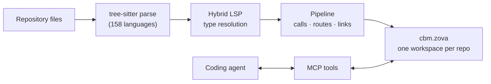

# codebase-memory-mcp

A local MCP server that indexes a codebase into a knowledge graph your coding agent can query.

codebase-memory-mcp parses your repositories with tree-sitter and type-aware resolvers, stores
functions, classes, calls, routes, and cross-service links in one local database, and exposes them
through 15 MCP tools. Your agent asks "what calls `ProcessOrder`?" and gets the answer from the graph
instead of grepping file by file.

[](https://github.com/octacity-org/codebase-memory-mcp/releases/latest)
[](LICENSE)
[](https://github.com/octacity-org/codebase-memory-mcp/actions/workflows/ci.yml)
[](https://arxiv.org/abs/2603.27277)

> [!IMPORTANT]
> This is a fork of [DeusData/codebase-memory-mcp](https://github.com/DeusData/codebase-memory-mcp).
> It adopts upstream fixes and features selectively. It does not mirror upstream releases, and its
> storage is different: every repository lives in one shared [Zova](https://github.com/ata-sesli/zova)
> database instead of a SQLite file per project.

## Contents

- [Install](#install)
- [Quick start](#quick-start)
- [Upgrading to 2.0](#upgrading-to-20)
- [How it works](#how-it-works)
- [What it can do](#what-it-can-do)
- [MCP tools](#mcp-tools)
- [Graph data model](#graph-data-model)
- [Agents](#agents)
- [CLI](#cli)
- [Configuration](#configuration)
- [Storage and Zova operations](#storage-and-zova-operations)
- [Build from source](#build-from-source)
- [Diagnostics and troubleshooting](#diagnostics-and-troubleshooting)
- [Current boundaries](#current-boundaries)
- [Security](#security)
- [License](#license)

## Install

**macOS / Linux:**

```bash
curl -fsSL https://raw.githubusercontent.com/octacity-org/codebase-memory-mcp/main/install.sh | bash
```

**Windows (PowerShell):**

```powershell
Invoke-WebRequest -Uri https://raw.githubusercontent.com/octacity-org/codebase-memory-mcp/main/install.ps1 -OutFile install.ps1
Unblock-File .\install.ps1
.\install.ps1
```

If PowerShell refuses to run the script, use `PowerShell -ExecutionPolicy Bypass -File .\install.ps1`.

The installer downloads the release archive for your platform, verifies it against the release
`checksums.txt`, installs the binary to `~/.local/bin`, and configures every coding agent it detects.
It does not overwrite an existing different binary or MCP entry unless you ask it to.

| Option | Effect |
|--------|--------|
| `--dir=<path>` | Install somewhere other than `~/.local/bin` |
| `--skip-config` | Install the binary only; leave agent configuration alone |
| `--replace` | Replace a different existing binary |
| `--replace-config` | Replace a different existing MCP configuration entry |

Pass options through the pipe with `bash -s --`, for example
`curl -fsSL .../install.sh | bash -s -- --skip-config`.

### Release archives

Every [release](https://github.com/octacity-org/codebase-memory-mcp/releases/latest) ships these
archives plus `checksums.txt` (SHA-256):

| Platform | Archive |
|----------|---------|
| macOS, Apple Silicon | `codebase-memory-mcp-darwin-arm64.tar.gz` |
| macOS, Intel | `codebase-memory-mcp-darwin-amd64.tar.gz` |
| Linux x86_64, portable (installer default) | `codebase-memory-mcp-linux-amd64-portable.tar.gz` |
| Linux ARM64, portable (installer default) | `codebase-memory-mcp-linux-arm64-portable.tar.gz` |
| Linux x86_64, glibc | `codebase-memory-mcp-linux-amd64.tar.gz` |
| Linux ARM64, glibc | `codebase-memory-mcp-linux-arm64.tar.gz` |
| Windows x86_64 | `codebase-memory-mcp-windows-amd64.zip` |
| Windows ARM64 | `codebase-memory-mcp-windows-arm64.zip` |

The portable Linux binaries are statically linked. The glibc builds need a glibc at least as new as
the release runner's. All binaries target the baseline CPU of their architecture, so they also run
on older processors.

<details>
<summary>Manual install from an archive</summary>

Each archive contains the binary and the matching installer.

```bash
tar xzf codebase-memory-mcp-*.tar.gz
./install.sh
```

```powershell
Expand-Archive codebase-memory-mcp-windows-amd64.zip -DestinationPath .
Unblock-File .\install.ps1
.\install.ps1
```

On macOS the `install` command removes the quarantine attribute and ad-hoc signs the binary. On
Windows, SmartScreen may warn about unsigned software; check the archive against `checksums.txt`
before choosing **More info → Run anyway**.

</details>

### Update and uninstall

```bash
codebase-memory-mcp update
codebase-memory-mcp uninstall
```

The server also checks for a newer release on startup and mentions it on the first tool call.
`uninstall` removes the binary, agent configuration, skills, hooks, and instructions. It keeps the
shared `cbm.zova` database.

## Quick start

1. Install, then restart your coding agent.
2. Open a repository and ask the agent: **"Index this project."**
3. Ask structural questions:
   - "What calls `handleCheckout`, two levels up?"
   - "Show me the HTTP routes and which services call them."
   - "Which functions have no callers?"
   - "What does my uncommitted change affect?"

To index new projects automatically when a session starts:

```bash
codebase-memory-mcp config set auto_index true
```

Indexed projects stay fresh on their own: a background watcher detects git changes and re-indexes
only what changed.

## Upgrading to 2.0

2.0 changes the stored data and removes several tools. What happens when you upgrade from 1.x:

- **Database format.** A `cbm.zova` in an older Zova storage format (9–11) is converted once when
  the new binary starts. The conversion writes a verified new file and then swaps it in. If it
  fails, the log names the fix: `codebase-memory-mcp zova-ops migrate-format --json`.
- **Index format.** Each project takes one full re-index the next time it is indexed, instead of an
  incremental one. That run reports `"format_migration": true`. Incremental indexing resumes after
  it.
- **Per-project `.db` files** from releases before the shared database are no longer read or
  migrated. Re-index those repositories with `index_repository`.

Breaking changes:

| Change | What to do |
|--------|------------|
| `manage_adr` and `ingest_traces` tools removed | Drop them from prompts and scripts |
| Graph UI, website, and artifact export/import removed | Use `zova-ops` backups and workspace archives |
| `CALL_REFERENCE` edges split from `CALLS` | `CALLS` now means invocation only; see [Graph data model](#graph-data-model) |
| File nodes keep their extension in the qualified name | `node.h` and `node.c` are now two File nodes; re-query stored QNs |

New in 2.0: Zig type-aware call resolution, `compare_graphs`, `get_file_outline`, generation-bound
`search_graph` cursors, project-wide `check_index_coverage`, compact output, `file_path` to choose
between same-named `trace_path` and `get_code_snippet` targets, Cypher property-to-property
comparison, and memory-budgeted indexing that spills to disk.

## How it works

codebase-memory-mcp is a structural backend. It does not include an LLM; the agent you already use
turns your question into tool calls.

```text
You:    "what calls ProcessOrder?"
Agent:  trace_path(function_name="ProcessOrder", direction="inbound")
Server: walks the call graph, returns structured rows
Agent:  explains the call chain
```



Indexing runs in passes: structure, definitions, calls, HTTP and channel links, configuration, and
tests. Results publish atomically into the shared database. Incremental runs commit only the
affected graph, metadata, full-text, and vector rows; unchanged files are not rewritten.

Indexing keeps results in memory up to a budget (a fraction of system RAM, or `CBM_MEM_BUDGET_MB`)
and spills extraction results to disk beyond it, so a large repository does not have to fit in RAM.
The same budget covers the post-extraction phases; if the resident graph still exceeds it, indexing
stops before publication and the previously indexed generation keeps serving.

> **Research.** The design and benchmarks are described in the preprint
> [*Codebase-Memory: Tree-Sitter-Based Knowledge Graphs for LLM Code Exploration via MCP*](https://arxiv.org/abs/2603.27277).
> Across 31 real repositories it reports 83% answer quality with 10× fewer tokens and 2.1× fewer tool
> calls than file-by-file exploration.

## What it can do

### Understand structure

- **Architecture overview**: `get_architecture` returns languages, packages, entry points, routes,
  hotspots, boundaries, layers, and Louvain clusters in one call.
- **Call graph**: calls resolve across files and packages, using imports and inferred types.
- **Impact of a change**: `detect_changes` maps the git diff to affected symbols and rates the risk.
- **Dead code**: functions with no callers, excluding entry points.
- **Compare two indexes**: `compare_graphs` lists the nodes and edges added and removed between two
  indexed projects, for example two branches checked out side by side.

### Search

- **Structural search** (`search_graph`): regex names, labels, file patterns, degree filters.
- **Full-text search**: BM25 over names and signatures, aware of camelCase and snake_case.
- **Semantic search** (`semantic_query` in `search_graph`): vector search with the bundled
  `nomic-embed-code` model compiled into the binary. No API key or model service.
- **Code search** (`search_code`): grep over indexed files only.
- **Cross-repository search**: one `search_graph` request can search several indexed repositories;
  see [Cross-repository search](#cross-repository-search).

### Link services

- HTTP routes matched to call sites, with confidence scores.
- gRPC, GraphQL, and tRPC service detection, including protobuf routes.
- Event channels (`EMITS` / `LISTENS_ON`) for Socket.IO, EventEmitter, and generic pub-sub.
- Infrastructure as code: Dockerfiles, Kubernetes manifests, and Kustomize overlays become graph
  nodes.

### Resolve types with Hybrid LSP

Tree-sitter alone sees syntax. It cannot tell that `user.profile.display_name()` means
`Profile.display_name` three modules away. Hybrid LSP is a small C implementation of each language's
type-resolution rules, built into the binary. It runs on every parse and refines `CALLS` and `USAGE`
edges with types. No language server process, no per-project setup.

| Language | What it resolves |
|----------|------------------|
| Python | imports and submodules, dataclasses, generics, `@property`, `match`, narrowing, Pydantic, SQLAlchemy `Mapped[T]`, common stdlib |
| TypeScript / JavaScript / JSX / TSX | generics, JSX components, JSDoc in plain JS, `.d.ts`, re-exports, method chains |
| PHP | namespaces, traits, late static binding, PHPDoc |
| C# | global usings, records, LINQ method syntax, `Task<T>` unwrap, `var` inference |
| Go | cross-file package registry, generics, embedded structs, interface satisfaction |
| C / C++ | macros, `typedef` chains, header-source linking, templates, namespaces, `auto` |
| Java | imports, class hierarchy, overloads, lambdas and method references |
| Kotlin | extension functions, companion objects, scope functions, nullable unwrapping |
| Rust | `use` paths, `impl` and trait methods, trait bounds, UFCS, derive macros |
| Zig | receiver types from annotations, `@This()`, `@import`, return types, captures, and type functions; `build.zig.zon` path dependencies map `@import("name")` to the dependency's module |

Other languages fall back to name-based resolution. Where the Zig resolver cannot prove a receiver's
type, it emits no edge rather than a guessed one.

### Languages

158 languages are parsed with vendored tree-sitter grammars compiled into the binary. Support tiers
decide how much of the test suite covers a language; all of them index the same way.

| Tier | Languages |
|------|-----------|
| 1 (default test suite) | Bash, C, C++, C#, CSS, Dart, Elixir, Go, Haskell, HCL, HTML, Java, JavaScript, JSON, Kotlin, Lua, Markdown, Nix, PHP, PowerShell, Python, Ruby, Rust, Scala, Solidity, Swift, TSX, TypeScript, YAML, Zig |
| 2 (`CBM_TEST_TIERS=2`) | OCaml, Objective-C, Perl, Groovy, Erlang, R, SCSS, TOML, SQL, Dockerfile, Clojure, F#, Julia, CUDA, Fortran, MATLAB, XML, Makefile, CMake, Protobuf, GraphQL, Vue, Svelte, Go module, Kustomize, Kubernetes manifests |
| 3 (`CBM_TEST_TIERS=all`) | Everything else, from Ada and Astro to WGSL and Zsh |

Package resolution reads manifests to map bare imports such as `@myorg/pkg`, `github.com/foo/bar`,
or `use my_crate::foo`: `package.json`, `go.mod`, `Cargo.toml`, `pyproject.toml`, `composer.json`,
`pubspec.yaml`, `pom.xml`, `build.gradle`, `mix.exs`, `*.gemspec`, and `build.zig.zon`.

### Performance

This fork's shared Zova database compared with the same CBM build on plain SQLite (ReleaseSafe
medians):

| Area | TOPS | Deno |
|------|-----:|-----:|
| Full indexing | 5.7% slower | 6.1% slower |
| Incremental indexing | 76.9% faster | 51.6% faster |
| Storage | 12.9% larger | 2.4% smaller |
| Vector search p95 | 76.6% faster | 86.2% faster |
| Result parity | exact | exact |

Full indexing is the tradeoff; the shared database pays off on repeated indexing and vector
retrieval. For scale, the original SQLite design fully indexed the Linux kernel (28M LOC, 75K files)
in about 3 minutes, with Cypher queries and depth-5 traces in milliseconds. See
[docs/BENCHMARK.md](docs/BENCHMARK.md).

## MCP tools

### Indexing

| Tool | What it does |
|------|--------------|
| `index_repository` | Index a repository. The watcher keeps it fresh afterwards. |
| `index_status` | Indexing state of a project, with a parse-coverage summary. |
| `check_index_coverage` | Extraction coverage per path and directory: partial parses with line ranges, skipped and excluded files, freshness. With no path arguments it covers the whole project. A best-effort signal, not a completeness guarantee. |
| `list_projects` | Indexed projects in selector order, with `offset`/`limit` paging and optional node and edge counts. |
| `delete_project` | Remove a project and its data from the shared database. |

### Querying

| Tool | What it does |
|------|--------------|
| `get_graph_schema` | Node and edge counts, relationship patterns, properties per label. A good first call. |
| `get_architecture` | Languages, packages, routes, hotspots, clusters. |
| `search_graph` | Structural, full-text, and semantic search. Page with `limit`/`offset`, or pass `next_cursor` back as `cursor`. |
| `search_code` | Text search within indexed files. |
| `trace_path` | Who calls a function and what it calls, to a bounded depth (alias `trace_call_path`). |
| `get_code_snippet` | Source of a symbol by qualified name. |
| `get_file_outline` | Bounded symbol outline of one indexed file. |
| `query_graph` | Read-only Cypher query. |
| `detect_changes` | Map the git diff to affected symbols and blast radius. |
| `compare_graphs` | Nodes and edges added and removed between two indexed projects. |

Behavior worth knowing:

- **Cursors** are tied to the query arguments and the index generation. A cursor used after a
  re-index fails with `stale_cursor` instead of skipping or repeating rows.
- **Ambiguous names**: when several symbols share a name, pass `file_path` to `trace_path` or
  `get_code_snippet` to choose one.
- **Compact output**: `search_graph`, `query_graph`, `trace_path`, `search_code`, `get_architecture`,
  `list_projects`, and `check_index_coverage` accept `format: "compact"`, which returns indented text
  with tabular rows instead of JSON. JSON stays the default.

### Cross-repository search

All indexed repositories share one database, so `search_graph` can search several at once:

```json
{"projects": ["codebase-memory-mcp", "AnotherFolder/codebase-memory-mcp"], "query": "update user profile"}
```

Use `{"projects": ["*"]}` for every ready, healthy workspace. Full-text, structural, and semantic
results are ranked and paged across the combined scope. Each result names its `project`; pass it
with the `qualified_name` to `get_code_snippet`.

Selectors come from repository paths. The first repository claims its directory name; a later one
with the same name gets the shortest unique parent-qualified name, such as
`AnotherFolder/codebase-memory-mcp`. `list_projects` shows the selectors.

## Graph data model

**Node labels:** `Project`, `Package`, `Folder`, `File`, `Module`, `Class`, `Function`, `Method`,
`Interface`, `Enum`, `Type`, `Route`, `Resource`

**Edge types:** `CONTAINS_PACKAGE`, `CONTAINS_FOLDER`, `CONTAINS_FILE`, `DEFINES`, `DEFINES_METHOD`,
`IMPORTS`, `CALLS`, `CALL_REFERENCE`, `HTTP_CALLS`, `ASYNC_CALLS`, `IMPLEMENTS`, `INHERITS`,
`HANDLES`, `USAGE`, `CONFIGURES`, `WRITES`, `MEMBER_OF`, `TESTS`, `USES_TYPE`, `EMITS`,
`LISTENS_ON`, `DATA_FLOWS`, `SIMILAR_TO`, `SEMANTICALLY_RELATED`, `FILE_CHANGES_WITH`

`CALLS` means invocation only. A function named as a value without being called (passed as an
argument, assigned, Java `A::m`, Kotlin `::f`, PHP `f(...)`) becomes `CALL_REFERENCE` when the type
resolver proves the single target; otherwise it stays `USAGE`. `trace_path` follows `CALLS` by
default; pass `edge_types: ["CALLS", "CALL_REFERENCE"]` to follow references too.

**Qualified names** look like `<project>.<path_parts>.<name>`. File nodes keep their extension;
symbols and modules do not. Use `search_graph` to find a qualified name.

### Cypher subset

`query_graph` accepts a read-only openCypher subset:

- **Clauses:** `MATCH`, `OPTIONAL MATCH`, multiple `MATCH`, `WHERE`, `WITH … WHERE`, `RETURN`,
  `ORDER BY`, `SKIP`, `LIMIT`, `DISTINCT`, `UNWIND`, `UNION [ALL]`, `CASE`.
- **Patterns:** labels, label alternation `(n:A|B)`, relationship types and direction,
  variable-length paths `[*1..3]`, inline property maps.
- **WHERE:** comparisons, including between two bound properties (`a.name = b.name`);
  `AND/OR/XOR/NOT`; `IN`; `CONTAINS`, `STARTS WITH`, `ENDS WITH`; `IS [NOT] NULL`; regex `=~`;
  label tests; single-hop `EXISTS { (n)-[:TYPE]->() }`.
- **Aggregates:** `count` (with `DISTINCT`), `sum`, `avg`, `min`, `max`, `collect`.
- **Functions:** `labels`, `type`, `id`, `keys`, `properties` (list results can be indexed, as in
  `labels(n)[0]`); `toLower`, `toUpper`, `toString`, `toInteger`, `toFloat`, `toBoolean`; `size`,
  `length`, `trim`, `ltrim`, `rtrim`, `reverse`; `coalesce`, `substring`, `replace`, `left`, `right`.

```cypher
MATCH (f:Function) WHERE NOT EXISTS { (f)<-[:CALLS]-() } RETURN f.name LIMIT 20
```

Anything outside the subset (writes, `MERGE`, `CALL`, list or map literals, comprehensions, path
functions, parameters) fails with an `unsupported …` error instead of returning empty results.

## Agents

`install` detects these agents and configures each one it finds:

| Agent | MCP config | Instructions | Hooks |
|-------|------------|--------------|-------|
| Claude Code | `.claude/.mcp.json` | Skills | PreToolUse on Grep/Glob (adds graph context, never blocks) |
| Codex CLI | `.codex/config.toml` | `.codex/AGENTS.md` | SessionStart reminder |
| Gemini CLI | `.gemini/settings.json` | `.gemini/GEMINI.md` | BeforeTool and SessionStart reminders |
| Antigravity | `.gemini/config/mcp_config.json` | `antigravity-cli/AGENTS.md` | SessionStart reminder |
| Zed | `settings.json` | — | — |
| OpenCode | `opencode.json` | `AGENTS.md` | — |
| Aider | — | `CONVENTIONS.md` | — |
| KiloCode | `mcp_settings.json` | `~/.kilocode/rules/` | — |
| VS Code | `Code/User/mcp.json` (and each profile) | — | — |
| Cursor | `~/.cursor/mcp.json` | — | — |
| OpenClaw | `~/.openclaw/openclaw.json` | — | — |
| Kiro | `~/.kiro/settings/mcp.json` | — | — |
| Junie | `~/.junie/mcp/mcp.json` | — | — |

Hooks always exit 0. The Claude Code hook watches `Grep` and `Glob` (never `Read`) and, when the
search term matches indexed symbols, adds them as context. Its file is still named
`cbm-code-discovery-gate` for compatibility with existing installs, but it never gates.

<details>
<summary>Configure an MCP client by hand</summary>

```json
{
  "mcpServers": {
    "codebase-memory-mcp": {
      "command": "/absolute/path/to/codebase-memory-mcp",
      "args": []
    }
  }
}
```

Restart the agent. In Claude Code, `/mcp` should list `codebase-memory-mcp` with 15 tools.

</details>

## CLI

Every MCP tool runs from the command line:

```bash
codebase-memory-mcp cli index_repository '{"repo_path": "/path/to/repo"}'
codebase-memory-mcp cli search_graph '{"name_pattern": ".*Handler.*", "label": "Function"}'
codebase-memory-mcp cli trace_path '{"function_name": "Search", "direction": "both"}'
codebase-memory-mcp cli query_graph '{"query": "MATCH (f:Function) RETURN f.name LIMIT 5"}'
codebase-memory-mcp cli --raw search_graph '{"label": "Function"}' | jq '.results[].name'
```

The other subcommands are `install`, `uninstall`, `update`, `config`, and `zova-ops` (below).

## Configuration

```bash
codebase-memory-mcp config list                        # show settings
codebase-memory-mcp config set auto_index true         # index new projects on session start
codebase-memory-mcp config set auto_index_limit 50000  # skip auto-index above this many files
codebase-memory-mcp config set auto_watch false        # don't register the background watcher
codebase-memory-mcp config reset auto_index            # back to the default
```

`auto_watch` defaults to `true`. Turn it off to keep each session limited to explicit indexing.

### Environment variables

| Variable | Default | Effect |
|----------|---------|--------|
| `CBM_CACHE_DIR` | `~/.cache/codebase-memory-mcp` | Where `cbm.zova` and settings live. |
| `CBM_ALLOWED_ROOT` | unset | Refuse to index any path that resolves outside this directory. Useful when an untrusted caller drives the server. |
| `CBM_WORKERS` | detected | Indexing workers. `0` is sequential; `1`–`256` sets the count. |
| `CBM_MEM_BUDGET_MB` | fraction of RAM | Indexing memory budget in MiB. Beyond it, extraction results spill to disk; if the resident graph still exceeds it, post-extraction phases stop before publication. |
| `CBM_LOG_LEVEL` | `info` | `debug`, `info`, `warn`, `error`, or `none`. Logs go to stderr; stdout carries MCP JSON-RPC. |
| `CBM_DIAGNOSTICS` | off | `1` writes periodic resource snapshots; see [Diagnostics](#diagnostics-and-troubleshooting). |
| `CBM_DUMP_VERIFY_MIN_RATIO` | `0.5` | If fewer than this fraction of indexed nodes persist, `index_repository` reports `status: "degraded"`. `0` disables the check. |
| `CBM_DOWNLOAD_URL` | GitHub releases | Override the update download URL. |

### Ignoring files

Ignore rules layer: built-in patterns (`.git`, `node_modules`, …), then the `.gitignore` hierarchy,
then `.cbmignore` (gitignore syntax, project-specific). Symlinks are always skipped. See
[docs/cbmignore.md](docs/cbmignore.md).

### Extra file extensions

Map extra extensions to a supported language in `.codebase-memory.json` at the repository root, or
globally in `~/.config/codebase-memory-mcp/config.json` (or under `$XDG_CONFIG_HOME`):

```json
{"extra_extensions": {".blade.php": "php", ".mjs": "javascript"}}
```

Project entries win over global ones. Unknown languages and extensions without a leading `.` are
skipped with a warning. The full reference, including accepted language names, is in
[docs/CONFIGURATION.md](docs/CONFIGURATION.md).

## Storage and Zova operations

Every indexed repository is an isolated workspace in one file,
`${CBM_CACHE_DIR:-~/.cache/codebase-memory-mcp}/cbm.zova`. Zova stores the graph topology, edge
payloads, traversal indexes, full-text rows, and int8 vectors natively, and the file survives agent
and machine restarts. Current storage: CBM schema 7 on Zova storage format 12.

`zova-ops` maintains that file. Every command needs `--json` and prints one JSON object. Exit code
`0` is success or no-op, `1` is a refusal or failure, `2` is invalid syntax.

```bash
codebase-memory-mcp zova-ops status --json
codebase-memory-mcp zova-ops health --json
codebase-memory-mcp zova-ops backup --output /safe/path/cbm-backup.zova --json
codebase-memory-mcp zova-ops restore --input /safe/path/cbm-backup.zova --confirm-replace --json
codebase-memory-mcp zova-ops export-database --output /safe/path/database-archive --json
codebase-memory-mcp zova-ops import-database --input /safe/path/database-archive --confirm-replace --json
codebase-memory-mcp zova-ops export-workspace --workspace-id WORKSPACE_ID --output /safe/path/workspace-archive --json
codebase-memory-mcp zova-ops import-workspace --input /safe/path/workspace-archive --json
codebase-memory-mcp zova-ops delete-workspace --workspace-id WORKSPACE_ID --confirm-workspace WORKSPACE_ID --json
codebase-memory-mcp zova-ops recover-workspace --workspace-id WORKSPACE_ID --repo-path /absolute/repository --json
codebase-memory-mcp zova-ops compact --json
codebase-memory-mcp zova-ops migrate-format --json
```

Safety rules:

- `restore` and `import-database` require `--confirm-replace`. `delete-workspace` requires the exact
  workspace ID again as `--confirm-workspace`.
- A replacement is verified before the live file moves. An interruption leaves either the previous
  verified database or a retryable recovery artifact.
- `compact` runs only when reclaimable space is at least 64 MiB and 10% of the file, and free disk is
  at least the larger of 8 GiB or the database size plus 1 GiB.
- `health` tells a damaged workspace (`workspace_rebuild`: rebuild that workspace from source) from a
  damaged file (`whole_file_recovery`: restore a verified backup). Without a backup, recovery
  quarantines the corrupt file and creates no replacement.

`scripts/zova-operations.sh` wraps these commands with a disk guard, serialization, progress on
stderr, and JSON reports under `build/zova-operations`.

## Build from source

Requirements: a C and C++ compiler (clang or gcc), zlib, git, and
[Zig 0.17.0](https://ziglang.org/download/) for the Zova library and the Zig support objects.

```bash
git clone https://github.com/octacity-org/codebase-memory-mcp.git
cd codebase-memory-mcp
scripts/build.sh
# binary: build/c/codebase-memory-mcp
```

Builds link an immutable Zova snapshot in `.zova-sdk`, not a live Zova checkout. The development
loop:

```bash
scripts/zova-pin-current.sh            # snapshot the built Zova library and headers (once)
scripts/zova-build-once.sh             # production binary, no tests
scripts/zova-run-tests.sh zova mcp     # build and run only these test groups
scripts/zova-run-tests.sh              # the full C test runner CI uses
scripts/zova-pin-current.sh --refresh  # adopt a new Zova build on purpose
```

The wrappers keep Zig caches under `build/.zova-build-cache`, hold a build lock against overlapping
builds, and refuse to start with less than 8 GiB free (`CBM_ZOVA_MIN_FREE_GB` changes the guard).

## Diagnostics and troubleshooting

The server runs locally and sends no telemetry, so a slow leak or regression on your machine stays
invisible unless you capture it. Set `CBM_DIAGNOSTICS=1` in the MCP server's environment and
reproduce the problem. The server writes to the system temp directory:

| File | Contents |
|------|----------|
| `cbm-diagnostics-<pid>.ndjson` | One line every 5 s: `rss`, `committed`, peaks, page faults, open files, query count. Kept after exit; rotates past ~8 MB. Attach this to memory and performance issues. |
| `cbm-diagnostics-<pid>.json` | The latest snapshot only. Removed on clean exit. |

The trajectory holds resource counters only, no source code or query text.

| Problem | Fix |
|---------|-----|
| The agent does not list the server | Use an absolute binary path in the MCP config and restart the agent. |
| `index_repository` fails | Pass an absolute `repo_path`. Check `CBM_ALLOWED_ROOT` if it is set. |
| `trace_path` finds nothing | Find the exact name first with `search_graph(name_pattern=".*Partial.*")`. |
| Results come from the wrong project | Pass `project`; `list_projects` shows the selectors. |
| Indexing reports a memory-budget error | Raise `CBM_MEM_BUDGET_MB` or lower `CBM_WORKERS`. |
| Binary not found after install | Add `~/.local/bin` to `PATH`. |

## Current boundaries

- **Cross-repository search, not cross-repository topology.** `search_graph` spans repositories, but
  `query_graph` and `trace_path` stay inside one, and no edges connect workspaces.
- **Full indexing is slightly slower** than the plain SQLite design (about 6% in the benchmarks
  above); incremental indexing is much faster.
- **Type-aware resolution covers ten language families.** Other languages use name-based
  resolution, which can miss or merge same-named targets.
- **Index coverage is best-effort.** `check_index_coverage` reports partial parses and skipped files;
  it does not prove the graph is complete.
- **No built-in LLM.** Natural-language questions need an MCP client.

## Security

Indexing, storage, vector search, and queries run on your machine. Nothing is uploaded, and no hosted
database, API key, or model service is needed. The installer verifies each archive against the
release checksums before extracting it. The tool writes to your agents' configuration files, so
audit the [source](https://github.com/octacity-org/codebase-memory-mcp) first if your environment
requires it. Report vulnerabilities as described in [SECURITY.md](SECURITY.md).

## License

MIT. See [LICENSE](LICENSE).
